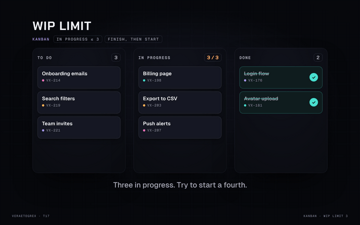

# WIP Kanban

**The column is full. It pushes back.**



**Live demo:** [veraetogrex-portfolio.github.io/wip-kanban](https://veraetogrex-portfolio.github.io/wip-kanban/) · **Mockup:** [full-screen version](https://veraetogrex-portfolio.github.io/wip-kanban/mockup/wip-kanban.html)

A kanban board whose "In progress" column holds at most three cards. Drag a fourth in and the column pushes back like a full lift; move one to Done and the slot opens.

## Use it

Three files, no build step, no dependencies, no web fonts:

```
index.html   markup
style.css    styles and keyframes
script.js    behaviour
```

Download the repo and open `index.html`, or copy the three files into your project.

## Try it

- Drag a card from To do into In progress while it holds three: it stretches in, then springs back.
- Drag a card from In progress to Done, then try again: now it fits.

## Make it yours

`data-limit` on a column in `index.html` sets its limit; `PULL` sets how far a rejected card can stretch into a full column.

## What's in `mockup/`

The full 1440×900 screen this component was shot in for the reel:

- `mockup/wip-kanban.html` — interactive. `D` plays the demo, `R` resets.
- `mockup/wip-kanban.autoplay.html` — the scripted loop the reel was recorded from.
- URL flags: `?frame` puts the screen in a browser window, `?clean` hides the control panel, `?once` plays the demo once.

The mockup loads the same `style.css` and `script.js` from the root, plus a shared stage runtime and bundled fonts from `mockup/_shared/`. The component in the root doesn't need any of it.

---

Component 17 of a series. New one every day on Instagram [@veraetogrex_portfolio](https://www.instagram.com/veraetogrex_portfolio/) · all components: [github.com/veraetogrex-portfolio](https://github.com/veraetogrex-portfolio)

MIT licensed.
